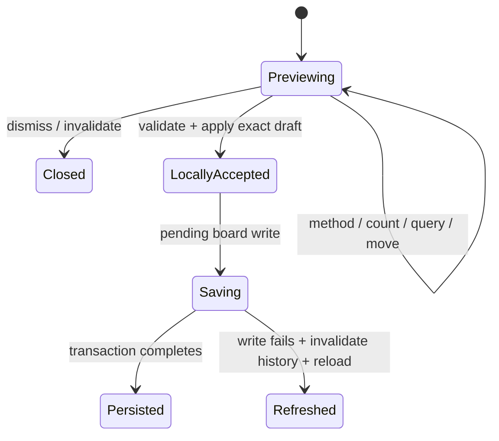

# State machine inventory

Audit date: 2026-11-06. Baseline: `4796ffc3993c3c5637b6625ad5d01004e4338ee8`.
Branch: `codex/cleanup-state-machines`.

## Scope and interpretation

This is a source audit of the committed application, including hooks, worker clients, workers, persistence, timers, browser event handlers and native DOM disclosures. Existing unpublished context-help drafts in the developer checkout are outside this baseline.

A machine here means remembered control state that changes which events are allowed or what happens next. A boolean can encode a small machine. A promise, pointer capture, DOM attribute, request token or persisted marker can encode part of a larger one. Numeric coordinates, search strings and counts are usually the machine's data rather than additional lifecycle states.

The inventory groups related implementations into **44 machine families**, including parallel and nested machines. It is not a count of independent flat finite-state machines. State names below describe the implementation; most are not declared as those types in the code. A representable combination is not evidence that a user can reach it, and this audit does not establish new runtime bugs.

Static coverage: 100 application `.ts`/`.tsx` modules after excluding tests, declarations and `testSetup.ts`; an import/re-export/dynamic-import/worker-URL scan connects 99 to `main.tsx` (including type-only imports). `StackNameInput.tsx` has no application import. Lifecycle-bearing sources were checked against event handlers, async completion paths and relevant existing tests. Browser internals and Framer Motion's internal machines are outside scope.

## A. Project, data and persistence

| ID / family | State carried today | Inferred states and transitions | Sources |
| --- | --- | --- | --- |
| M01 Project startup and collection hydration | `activeId`, `currentId`, `projectVersion`, `collectionVersion`, `requestedCollection`, effect liveness | Startup reads project summaries and saved selection; selecting a project empties its collection and starts a read. Refresh/mutation advances versions; late responses are discarded; unmount invalidates work. Loading, loaded-empty and loaded-with-data are not an explicit union. | [useProjectLibrary](../src/useProjectLibrary.ts#L5) |
| M02 Application navigation and overlays | `view`, `selected`, `reviewContext`, `settingsOpen`, `initialBrowser`, `initialStashId`, recent-import context | Project screen ↔ workspace; image review and settings are parallel overlays. Opening a folder/imported-image view supplies entry context. Project switch/create/restore resets several fields together. Review has its own nested destination chooser (M43). | [LibraryApp state](../src/LibraryApp.tsx#L75), [view reset and entry](../src/LibraryApp.tsx#L190) |
| M03 Foreground operation ownership | `busy`, `progress`, `error`, `message`, `boardSaves`, operation-specific ref locks | Idle → running import/export/mutation/Undo → success or error → available again. `run()` is an async wrapper, not a queue or mutex. Other handlers also set the same `busy` flag directly. Board saves use a separate counter. The operation that owns the busy state is implicit. | [LibraryApp.run](../src/LibraryApp.tsx#L123), [board operations](../src/LibraryApp.tsx#L223) |
| M04 CLIP setting persistence and replay | `settingsLock`, optimistic project settings, `folder-sort:pending-clip:*` journal | Saved on/off → optimistic toggle + journal → IndexedDB commit → journal removal; caught failure restores the previous UI value. Startup replays an interrupted journal before listing projects. This is separate from model/index readiness. | [setting UI transaction](../src/LibraryApp.tsx#L306), [journal and replay](../src/imageStore.ts#L99), [setting write](../src/imageStore.ts#L168) |
| M05 Image import intake | `pendingImport`, global busy/progress, discovered entries, known paths, per-file transaction progress; drop-zone `dragging` | Files/directory discovery → validation → optional source-folder choice → deduplication/folder creation → per-image commits → refreshed collection. A later failure retains completed imports and refreshes them. First successful collection import enters the workspace. Drop-zone highlight is a small presentation submachine. | [discovery](../src/LibraryApp.tsx#L42), [ingest and choice](../src/LibraryApp.tsx#L162), [imageImport](../src/imageImport.ts#L5), [addImages](../src/imageStore.ts#L622), [drop zone](../src/ProjectScreen.tsx#L27) |
| M06 Backup restore saga | Parsed manifest, new project ID, `written`, `writtenCategories`, local try/catch progress | Read/validate → remap categories → write each asset/image → publish project + active ID. Caught failure enters compensating deletion before rejecting. Completion and rollback are encoded by control flow; they are not persisted workflow states. | [importProjectFiles](../src/projectArchive.ts#L152), [import entry points](../src/LibraryApp.tsx#L321) |
| M07 Archive/folder export | Global foreground state, selected format, immutable export snapshots, directory handles, file-writing loop | Request → snapshot/package, or directory picker → write files → hand off ZIP/download or finish directory writes → success/error. Picker cancellation reaches the foreground error path. Download handoff does not prove that the browser finished saving a file. | [export orchestration](../src/LibraryApp.tsx#L347), [backup and sorted exporters](../src/projectArchive.ts#L12), [download resource lifetime](../src/download.ts#L1) |
| M08 Persisted image location | `categoryId`, `rootOnBoard`, coordinates, `stashOrder`; compatibility mirrors `placement`/`boardScope` | **Waiting:** no folder + `rootOnBoard === false`. **Staging:** no folder + `rootOnBoard !== false`. **In folder:** a folder ID. Add/move/remove/Undo transition between these states. Coordinates are per-location layout data; `boardScope` is a compatibility mirror, not a second membership. Missing `rootOnBoard` preserves legacy Staging. | [image schema and normalization](../src/imageStore.ts#L24), [assignment](../src/imageStore.ts#L433), [place](../src/imageStore.ts#L496), [remove to waiting](../src/imageStore.ts#L532), [scope predicate](../src/stashBoard.ts) |
| M09 Folder-board initialization and migration | `folder-boards:v1:*`, `layoutInitialized`, missing positions, `framedFolders`, `appearanceFramed`, saved appearance version | Legacy → atomically normalized. Unprepared/missing-layout board → fill missing positions → initialized. Workspace separately tracks whether migration/first appearance should frame a board. Existing positioned images remain fixed. An initialized folder can still need positions for newly moved images. | [migration](../src/imageStore.ts#L54), [prepareStashBoard](../src/imageStore.ts#L210), [workspace preparation/framing](../src/SortingWorkspace.tsx#L228) |
| M10 Folder naming intent and suggestions | Persisted `unnamed`/`namingPrompted`; editor `open`, `loading`, `saving`, selected suggestion, `edited`, `prompted`, `saveLock`, effect liveness | Untitled + not prompted → first-entry prompt → prompted-but-untitled or explicitly named. The panel separately loads suggestions, accepts manual edits, saves, reports errors and retries. Late results cannot replace a user's edit. Showing the prompt persists its seen state. A literal name “Untitled folder” can be explicitly named. | [folder schema](../src/imageStore.ts#L69), [prompt persistence](../src/stashStore.ts#L8), [FolderNameSuggestions](../src/FolderNameSuggestions.tsx#L11) |
| M11 Folder mutation form family | Independent draft/error/pending states and global busy; tile `initialNaming` | Tile rename, project-screen rename and workspace rename each implement editing → submitting → closed or error/editing. The move/create chooser implements open → submitting chosen action → close or error. Empty-folder deletion has eligible/ineligible + pending/error states and transaction-time emptiness checks. Initial tile naming may merge into creation's Undo entry; later naming gets its own entry. These are separate instances with differing cancellation rules. | [tile rename](../src/StashBoardLayer.tsx#L29), [project rename](../src/ProjectScreen.tsx#L30), [workspace rename](../src/WorkspaceBar.tsx#L45), [chooser](../src/StashPicker.tsx#L10), [delete action](../src/EmptyStashAction.tsx#L5), [delete/restore transaction](../src/stashStore.ts#L17) |
| M12 Optimistic board persistence | Live image ref/state, captured inverses, history IDs, optimistic order markers, pending-save counter | Plan → remember inverse + apply locally → saving → durable success, or invalidate affected history + refresh from storage. Multiple saves can be in flight; completion reconciles against newer local values. `place`/`removeFromBoard` return before the write finishes. | [useBoardActions](../src/useBoardActions.ts#L14), [save reconciliation](../src/useBoardActions.ts#L18) |
| M13 Action history and Undo execution | Bounded entries, latest-entry ref, project ownership, sequence IDs, `undoLock` | Empty ↔ Undo available → restoring → pop exact current entry on success; failure retains retry context. Project switch clears history. Failed optimistic saves invalidate entries from an ID onward. Creation/first rename can update an existing entry. This is independent of the button highlight (M44). | [useActionHistory](../src/useActionHistory.ts#L19), [Undo orchestration](../src/LibraryApp.tsx#L130), [initial-name grouping](../src/LibraryApp.tsx#L257) |

## B. Board navigation and gestures

| ID / family | State carried today | Inferred states and transitions | Sources |
| --- | --- | --- | --- |
| M14 Folder navigation transaction | Scope state/ref, `navigationRequest`, mounted/category refs, animation handles, DOM `inert`/`aria-busy` | Viewing → preparing destination → leaving animation → commit scope/reset contextual state → entering animation → interactive + focus restoration. New requests cancel old motion; deletion can redirect to parent. Drop-triggered navigation has different entry guards. | [navigateStash](../src/SortingWorkspace.tsx#L409), [removed current folder](../src/SortingWorkspace.tsx#L308), [motion and control locking](../src/useStashNavigationMotion.ts#L11) |
| M15 Camera ownership, restore and persistence | Saved per-scope cameras, zoom/center, last requested/emitted center, `suppressCameraScrollRef`, debounce/RAF handles, preference listeners | Restore or explicit camera request → programmatic scroll with suppression → accept user pan/zoom/resize → update visible window → debounce/flush saved camera. Reveal waits for expanded-browser layout to settle and checks scope again. Folder-anchor Undo restores persisted and mounted state via a listener registry. | [camera hook](../src/useBoardNavigation.ts#L8), [Board camera synchronization](../src/Board.tsx#L132), [reveal](../src/useBoardReveal.ts#L6), [anchor restore](../src/useBoardPreferences.ts#L5) |
| M16 Workspace selection | `selectedIds`, `selectedId`, `multiSelect`; workspace `selectionOrigin` | None/single/multiple selection, independently in normal/toggle mode and from browser/board. Plain press, modifier press, lasso, select-all, removal and navigation change selection. Drag snapshots the selected group. `selectedId` may be the last interacted ID after toggling it out of `selectedIds`; its semantics must be clarified before imposing a membership invariant. | [selection hook](../src/useWorkspaceSelection.ts#L6), [origin and selection entry points](../src/SortingWorkspace.tsx#L191), [card press/click](../src/DraggableCard.tsx#L162) |
| M17 Individual card press/drag | `dragArmed`, `isDragging`, press-selection snapshot, `draggedSincePress`, `quickDragHandled`, `dragCancelled`, Motion values and release listeners | Idle → pressed/armed → Motion dragging, or quick-release fallback → accepted drop or rejected/cancelled return → idle. Click selection and double-click review are competing outcomes. Pointer cancel restores origin; quick and Motion completion must commit at most once. Arrival animation can be interrupted by press. | [drag flags](../src/DraggableCard.tsx#L161), [pointer entry](../src/DraggableCard.tsx#L214), [quick fallback](../src/DraggableCard.tsx#L260), [Motion completion](../src/DraggableCard.tsx#L408) |
| M18 Selected-group drag | Gesture snapshot with IDs/origin/minimum, follower nodes/original transforms, `instantIds`, DOM follower attributes | No group → snapshot visible companions → live translation with boundary projection → commit positions while companions remain immediate → restore temporary DOM state. Cancel/unmount also restores followers. Selection is frozen at gesture start. | [useBoardGroupDrag](../src/useBoardGroupDrag.ts#L22), [group drop commit](../src/SortingWorkspace.tsx#L850) |
| M19 Mouse/pen pan and Space hand mode | Gesture ref, `space`, `otherPointer`, `suppressClick`, `handMode`, `panning`, pointer capture | Ready/hand armed → panning → moved-pan completion or blank click; release/cancel/blur/visibility/focus changes reset ownership. Releasing Space during a pan does not hand that gesture to a card. | [useBoardPan](../src/useBoardPan.ts#L34) |
| M20 Touch/pinch/trackpad camera takeover | Touch map, gesture/Safari anchor, `owned`, `cancelling`, `suppressClick`, pending camera/RAF, navigating flag | One background finger → pan; second finger → cancel card/folder drags and own pinch. Lifting a controlling finger retains ownership until remaining fingers lift. Native Safari gesture and Ctrl-wheel are additional inputs. Blur/hidden/cancel flush and reset. | [useBoardGestures](../src/useBoardGestures.ts#L15), [native-zoom suppression](../src/useWorkspaceZoomGuard.ts) |
| M21 Lasso selection | Nullable rectangle + append mode, separate pointer ID, pointer capture | Idle → pointer-owned rectangle → update → click-clear or selection commit → idle; cancel clears ownership and rectangle. Enabled by board configuration/modifiers and excluded for touch. | [Board lasso](../src/Board.tsx#L207) |
| M22 Folder tile movement | Header drag ref with pointer/start/delta, DOM group preview, saved anchor | Idle → header press → preview translation → threshold-qualified anchor commit/history, or small move/cancel → restore. Arrow keys commit discrete moves. This moves the container's anchor and retains image membership. | [tile handle](../src/StashBoardLayer.tsx#L75), [preview and commit](../src/SortingWorkspace.tsx#L387) |
| M23 Taking the top image out of a folder | `taking` ref, `started`, `dragged`, `takingOut`, deferred drop frame | Pressed preview → threshold crossing → shared image drag → deferred drop after pointer release → cleanup. A non-drag click opens the folder; a drag suppresses that click. Cancel/lost capture/unmount terminate extraction. | [extraction state](../src/StashBoardLayer.tsx#L36), [preview pointer handlers](../src/StashBoardLayer.tsx#L97) |
| M24 Cross-surface drop and assignment | Workspace `dragging` with origin, pointer/ghost refs, hovered folder/parent/browser, `assignmentLock` | Dragging from board/browser/tile → target classification → parent move, grouping, folder assignment, board placement, Staging removal or rejection. Drop precedence differs by source. Assignment locks span async store work and optional navigation. These outcomes are encoded in branching callbacks and boolean return values. | [workspace drag](../src/SortingWorkspace.tsx#L608), [assignment](../src/SortingWorkspace.tsx#L701), [drop routing](../src/SortingWorkspace.tsx#L822) |
| M25 Hold-to-create-folder | `hold` ref with target/point/ready/timer/serial + rendered `groupPreview` | No target → holding → ready after dwell → release on same valid target → create. Changing target, excessive movement, entering a folder, cancel or completion clears timer/cue. The ready cue is a render projection of the ref-owned hold. | [prepare/commit grouping](../src/SortingWorkspace.tsx#L559), [cue](../src/StashCreationCue.tsx) |

## C. Browser, intake and preview workflows

| ID / family | State carried today | Inferred states and transitions | Sources |
| --- | --- | --- | --- |
| M26 Browser panel visibility and resizing | Child `view.collapsed`/width, parent `expanded` + mirrored `browserPanel`, resize ref/capture | Collapsed ↔ docked ↔ expanded; resizing updates width while interaction pauses CLIP. Opening expanded clears collapsed; collapsing clears expanded. Parent mirror drives board layout, navigation guards and starter visibility. | [parent panel](../src/SortingWorkspace.tsx#L131), [browser state](../src/ImageBrowser.tsx#L44), [controls and resize](../src/ImageBrowser.tsx#L218) |
| M27 Browser context, scroll and keyboard focus | Persisted view + `importedOnly`, saved snapshot, deferred query, scroll restoration/anchor/return refs, pending focus, focus offset | Restore saved view → browse; temporary recent-import mode preserves the previous saved filters. Filter/order changes reset scroll; leaving import restores prior context; resizing/reflow anchors an image; keyboard navigation waits for a virtualized card to mount before focusing. Scrolling has its own active → idle debounce. | [ImageBrowser](../src/ImageBrowser.tsx#L44), [restore/reflow](../src/ImageBrowser.tsx#L102), [focus and context changes](../src/ImageBrowser.tsx#L149), [saved schema](../src/imageBrowserView.ts#L3) |
| M28 Browser ordering preparation | Order/reverse/random IDs, prepared hash/CLIP orders, `preparingOrder`, active-effect guards and revisions | Choose order → ensure required analysis → compute/apply latest order or report error. Random IDs reconcile with imports/deletions and persist. Subject order refreshes as indexing advances and holds during drags. Disabling CLIP switches away from semantic order. | [useBrowserOrder](../src/useBrowserOrder.ts#L28), [async preparation](../src/SortingWorkspace.tsx#L329), [CLIP-off reset](../src/SortingWorkspace.tsx#L727) |
| M29 First-use Staging starter | Module `sessionSeen`, persisted done marker, `seen`, `started`/`starting`, presence/exit animation | Unseen but ineligible ↔ visible when eligible → add/skip/manual intake or occupied board → permanently seen for that project/session. Submit is guarded against repeats. Clearing or Undo does not reset the welcome. Count/sample are data; the persistent lower intake has available/filtered-out/exhausted derived states. | [useRootIntake](../src/useRootIntake.ts#L4), [starter submit](../src/BoardStarter.tsx#L25), [visibility](../src/SortingWorkspace.tsx#L281), [persistent intake](../src/StagingIntake.tsx#L9) |
| M30 Random preview draft | Parent nullable draft/serial, frozen random pool, planned moves, initial layout key, `committed` | Closed → previewing; quantity/refresh changes draft → validate and accept optimistically, or reject and retain draft. Layout/scope/filter/selection/outside/Escape can dismiss. Decoration fades after acceptance while photos keep planned positions. Persistence continues under M12. | [parent ownership](../src/SortingWorkspace.tsx#L656), [RandomImageAdd](../src/RandomImageAdd.tsx#L20) |
| M31 Related/text preview draft | `open` + `openRef`, `loading`, `adding` + `committing`, request token/liveness, query debounce, promise cache, matches/moves, origin, batch history; draft-drag pointer ref | Closed → loading/search-debouncing or empty-query → preview/empty/error → optimistic acceptance or stale rejection. Method/count/query changes, candidate changes and CLIP availability have distinct reload rules. New requests supersede older results. Accepted batches advance the next origin; cancellation does not. Moving the whole draft is a nested idle/dragging/commit-or-revert gesture. | [state and visibility](../src/SimilarImageAdd.tsx#L38), [load/accept/invalidation](../src/SimilarImageAdd.tsx#L72), [draft movement](../src/SimilarImageAdd.tsx#L186), [acceptance boundary](../src/SortingWorkspace.tsx#L762) |
| M32 Board-wide find/add-similar | `matching`, `matchingLock`, `matchingRequest`, scope and mounted guards, selected result IDs | Idle → prepare reference/candidate analysis → rank → revalidate membership/scope → select/reveal existing matches or add/move new matches → idle/error notice. Navigation and CLIP-off invalidate results. This is a separate orchestration path from the selected-image preview controller. | [findSimilarImages](../src/SortingWorkspace.tsx#L737), [addSimilar](../src/SortingWorkspace.tsx#L776) |
| M33 Arrival, acceptance and transient feedback | Intake IDs/origins/900 ms timer, per-card `arriving` + Animation, captured-frame `played`, fade fallback timer, folder pulse and notice timers | New cards settle/arrive → normal; press cancels arrival. Accepted preview decoration captures before unmount, plays once and removes after finish/cancel/fallback. Folder pulses, intake icon pulses and notices are separate short presentation lifetimes. These do not own saved coordinates or durability. | [useImageIntake](../src/useImageIntake.ts#L20), [DraggableCard arrival](../src/DraggableCard.tsx#L129), [frame fade](../src/previewFrame.ts#L5), [notices](../src/SortingWorkspace.tsx#L358), [pulse](../src/SortingWorkspace.tsx#L701) |

## D. Background processing and resources

| ID / family | State carried today | Inferred states and transitions | Sources |
| --- | --- | --- | --- |
| M34 Metadata/perceptual/color indexing | Hydrated/active refs, current task promise, metadata and failed maps, running/progress snapshot, patch batch | Unhydrated → hydrate → determine missing capability → analyze one image at a time → flush metadata → ready. Concurrent requests wait, then fill additional needs. Per-image failures are skipped; unmount disposes client and prevents further UI updates. | [useImageAnalysis](../src/useImageAnalysis.ts#L12) |
| M35 CLIP content-index orchestration | Explicit `phase` **plus** enabled/active/stop/rebuilding/interacting refs, hydration/sync/running promises, cache/failed/priority maps and waiters | Phases: idle/loading/indexing/paused/ready/error/rebuilding. Enable prepares models, including empty projects; hydrate/synchronize stored vectors; index queued/priority images; pause/resume/retry/rebuild/disable/unmount manage work. Interaction yields work without changing phase. A phase alone does not specify whether the worker is resident or which waiters exist. | [phase type and refs](../src/useContentAnalysis.ts#L6), [client and pause](../src/useContentAnalysis.ts#L78), [run](../src/useContentAnalysis.ts#L124), [references/rebuild/effects](../src/useContentAnalysis.ts#L225) |
| M36 Worker-client request protocols | Worker presence, disposed/ready flags, initialization promise, pending request IDs and timeout handles | Each request: submitted → result/error/timeout/cancel; late unknown responses ignored. CLIP has shared initialization and terminates on timeout/error. Metadata analysis can continue through a yielding browser fallback after worker failure. Thumbnail worker failure also falls back, with restart governed by cache lifecycle. These similar protocols have intentionally different fallback contracts. | [ClipClient](../src/clipClient.ts#L10), [ImageAnalysisClient](../src/imageAnalysisClient.ts#L7), [thumbnail RPC](../src/imageThumbnails.ts#L122) |
| M37 CLIP worker model and inference runtime | Image/text model promises, `gpuFailed`, serial inference promise, cached image/text vectors, progress throttle | Unloaded → image model loading → GPU or WASM ready → quantized CPU text model loading/ready. Image GPU load/inference failure falls back to WASM. Text load rejection clears its promise for retry; text never falls back to fp32. Image/text inference serializes, disposes tensors and populates caches; text query cache is bounded. Worker termination owns final model release. | [clip.worker](../src/clip.worker.ts#L17), [model loaders](../src/clip.worker.ts#L31), [serial text encoding](../src/clip.worker.ts#L85), [job dispatch](../src/clip.worker.ts#L132) |
| M38 Thumbnail demand, cache and decoder lifetime | Owner interest sets, wanted/queued/loading/failed IDs, URL LRU, generation/disposed state, listener/RAF batches, worker-attempt flag | Per image: absent → wanted/queued → loading persisted preview or generate → ready/failed; uninterested entries become evictable. Disposal invalidates generation, rejects jobs and revokes URLs; activation permits a new lifecycle. Independent board/browser/preview consumers lease demand. Thumbnail UI subscriptions and preview image-load geometry are projections of this service. | [ImageThumbnailCache](../src/imageThumbnails.ts#L11), [activation/disposal](../src/imageThumbnails.ts#L174), [consumer subscriptions](../src/useThumbnailUrls.ts#L6), [preview lease](../src/BoardImagePreviews.tsx#L34) |
| M39 Interrupted CLIP-session recovery | Module `interrupted`, resident owner set, sessionStorage marker, pagehide/pageshow listeners | Clean → resident models + marker → normal release/navigation clears marker. Restoring an uncleared marker blocks heavy requests until explicit Retry. Cached ranking requests remain usable. Retrying, disposal and bfcache restoration have distinct effects. This is tab-scoped and separate from persisted project enablement. | [clipRecovery](../src/clipRecovery.ts#L1), [heavy-request guard](../src/clipClient.ts#L38), [explicit resume](../src/useContentAnalysis.ts#L286) |

## E. Menus, review and focus

| ID / family | State carried today | Inferred states and transitions | Sources |
| --- | --- | --- | --- |
| M40 Disclosures and nested menu pages | Native `details.open` mirrored by React `open`, parent submenu `page`, auto-open error request; additional native project `
` | Closed ↔ open; main ↔ view/similar/export/help pages; close resets page. Outside/Tab/Escape/action execution dismiss and may restore focus. Errors can request auto-open. Project management/folder/help disclosures also retain native DOM state, sometimes with an `open` prop derived from image count. | [ActionMenu](../src/ActionMenu.tsx#L9), [WorkspaceBar](../src/WorkspaceBar.tsx#L43), [project disclosures](../src/ProjectScreen.tsx#L63) |
| M41 Information hint / linked help popover | `open`, `pinned`, `over`, `skipFocus`, show/hide timers, native popover state | Hidden → hover delay → transient open → leave delay/hidden. Keyboard focus and click/tap can open/pin; panel hover/link focus retains it; Escape/outside/blur close. Focus restoration suppresses immediate reopening. Native top-layer and fallback rendering share this controller. | [InfoHint](../src/InfoHint.tsx#L12) |
| M42 Modal focus and deferred action focus | Native dialog state, captured opener, saved sibling inert/ARIA state; requested workspace focus + blocked flag/RAF | Mount → show modal/inert siblings/trap focus → nested dialog ownership → close/unmount restores previous sibling and focus state. Workspace actions separately request focus and wait through saving, dragging or chooser modality before trying an appropriate target. Folder navigation also restores modality-specific focus under M14. | [Modal](../src/Modal.tsx#L6), [deferred action focus](../src/useWorkspaceActionFocus.ts#L6) |
| M43 Original-image review and destination chooser | Selected image/context in app; reviewer URL, failed flag, effect liveness and nested chooser | Image change → release old URL/load original → ready or unavailable; navigation replaces the current load and stale completions are ignored. Move opens a nested chooser; keyboard image navigation is suspended while chooser is open or app is busy. Closing restores modal focus. | [ImageViewer](../src/ImageViewer.tsx#L21), [review context](../src/LibraryApp.tsx#L377) |
| M44 Undo control touch and highlight | `fresh` + expiry timer; pressed pointer/action ID snapshot; synthetic-click suppression | New history entry → temporarily highlighted → ordinary available button. Touch press → validate same action, bounds and movement → invoke once; cancel/swipe/action replacement rejects touch completion. Pointer-generated click is suppressed after handling touch; keyboard activation remains available. | [UndoControl](../src/UndoControl.tsx#L6) |

### Export PNG is an additional nested job under M07

The board PNG path has more lifecycle state than archive export: `imageExport.current` (AbortController), `exportStatus`, `exportError`, `exportNotice`, a notice timer and a mounted guard. Its sequence is snapshot → prepare canvas → decode/paint/dispose images serially → encode PNG → hand off download → notice. Cancel/unmount aborts work; failure reports an error; cleanup releases canvas/image resources. The controller prevents a second concurrent PNG job. Progress text is also used as a UI busy signal.

Sources: [workspace PNG controller](../src/SortingWorkspace.tsx#L913), [export UI state](../src/SortingWorkspace.tsx#L169), [renderer/resource cleanup](../src/boardExport.ts#L73).

### Shared infrastructure and dormant paths

- [libraryDatabase](../src/libraryDatabase.ts#L12) wraps IndexedDB's open/upgrade and active → committed/aborted transaction lifecycle. The platform owns that machine; application-specific atomicity belongs to M04–M12. Folder deletion/restoration and image deletion/restoration also have transaction-time existence/name/parent guards in `stashStore.ts` and `imageStore.ts`.
- [StackNameInput](../src/StackNameInput.tsx#L3) is an **unreferenced** edit → blur/Enter commit, Escape cancel machine. Keep it separate from the active inventory when choosing refactor work.
- `DraggableCard` still contains setup-mode resize-edge/keyboard branches. The current app passes sort mode and supplies no `onResizeStart`; these are dormant capabilities, not an active folder-sort resize workflow.
- `useStableCallback` mirrors callback data; `useWorkspaceZoomGuard` installs suppression listeners; `useImageActionPosition` coalesces layout measurements. They support the machines above but do not select a separate semantic workflow. Numeric view preferences, algorithms, count calculations, media display variants and CSS hover transitions are not counted as additional application machines.
- Object URL leases in the reviewer, thumbnail service, decoder fallbacks, board export and `download.ts` are resource lifetimes. Revoke/release belongs to the owning lifecycle, including error, cancel, supersession and unmount paths.

## Main coupling findings

### 1. Preview acceptance and saved completion are different events

`SimilarImageAdd.accept()` awaits `onAdd`, but `SortingWorkspace.acceptSimilarPreview()` calls the void optimistic board action and returns `true`. Random acceptance has the same boundary. The frame can fade and the draft can close while M12 still has a pending database save. A later save failure refreshes the collection and invalidates history.

This is current behavior, not a newly reproduced defect. A refactor should make the contract explicit: **accepted locally**, **persisted**, and **failed/recovered** are different outcomes. It must not accidentally delay photos until persistence or report an optimistic acceptance as durable success.

### 2. Gesture ownership crosses several components

One physical interaction may involve M17 card drag, M18 group followers, M20 touch takeover, M23 extraction, M24 drop routing and M25 grouping. Pointer cancel is a handoff/rollback event. Refactoring only a card's `isDragging` flag will not capture this system.

The highest-risk contracts are single completion, frozen group membership, pointer ownership, restoring temporary transforms, click suppression, and identical cancel behavior across Motion and the quick-release fallback. Browser/board/folder-preview drops deliberately return different boolean outcomes today.

### 3. Foreground availability has multiple owners

`busy` is written by `run`, folder mutation handlers, assignment, setting changes and preparation. Other exclusion state lives in `assignmentLock`, `settingsLock`, `stashDeleteLock`, `undoLock`, `matchingLock` and `boardSaves`. The control relationship is distributed and not represented by one typed operation owner.

The boolean representation alone permits confusing overlaps; existing UI guards/ref locks prevent many paths. Establish allowed concurrency before consolidating it. Preserve overlapping optimistic layout saves and separate background indexing.

### 4. Navigation is a transaction with animation-owned DOM state

M14 coordinates preparation, scope commit, per-folder camera restoration, selection/preview invalidation, inert controls and focus. Its request ID prevents stale completion. Cancellation must release DOM locks even when a newer navigation or folder deletion supersedes the old one. M15 handles camera updates without changing saved image positions.

### 5. CLIP already has an explicit phase, but an implicit full lifecycle

The seven phases are useful. They coexist with worker readiness/residency, enablement, interruption recovery, hydration, cache synchronization, current-task ownership, rebuilding, interaction yielding and waiting reference requests. These are parallel regions with data and effects, not seven mutually exclusive descriptions of the whole system.

### 6. Several apparent duplicates carry different semantics

- `selectedId` is not currently guaranteed to belong to `selectedIds`; it can preserve the last interacted card after a toggle removes it.
- `rootOnBoard: undefined` has legacy meaning; coercing it to `false` changes which images appear.
- `unnamed` is intentional persisted naming state; deriving it from the visible name loses explicit naming intent.
- Temporary import browsing preserves a saved view; it is not an ordinary filter change.
- Worker clients share request plumbing but have different fallback/termination policies.
- A history action can outlive the workspace that created it; anchor restoration has a mounted-instance registry for that reason.

## Suggested refactor order

1. **Preview draft controller (M30/M31).** Introduce a small typed lifecycle and explicit request-generation/acceptance effects. Keep random sampling, ranking methods and placement strategies separate. Distinguish accepted-local from saved completion. Preserve exact preview coordinates, frozen cohorts, stale-result rejection and cancellation.
2. **Foreground commands and persistence contracts (M03/M12/M13).** Name operation ownership and save completion; preserve the pending-save counter, optimistic ordering and inverse invalidation. Make completion/error outcomes observable before sharing more orchestration code.
3. **Drop outcomes and gesture coordination (M17–M25).** Introduce typed outcomes such as board move, folder move, return to waiting, create folder and reject. Keep pointer/Motion adapters and live DOM movement intact while moving decisions into testable transition logic.
4. **Folder navigation transaction (M14/M15).** Give request identity, preparation/exit/commit/entry/cancel and DOM cleanup one owner. Keep camera data scoped to each folder and preserve deferred focus.
5. **CLIP lifecycle (M35–M39).** Model phase, worker lifecycle and pending jobs as separate regions. Preserve saved-vector hydration into a preloaded worker, enable-before-import, bounded inference, explicit recovery retry and disposal.
6. **Naming/forms and browser continuity (M10/M11/M26/M27).** Share well-defined validation/submission pieces after recording the cancellation/focus differences. Treat temporary browsing context and scroll restoration as first-class transitions.
7. **Small disclosures/help (M40–M44).** Keep simple local open/closed state where sufficient. Consolidate only genuinely shared behavior; preserve native dialog/popover semantics and touch/keyboard differences.

Typed unions and local reducers are sufficient starting points. Continuous pointer coordinates, DOM measurements and animation handles can remain outside React render state. The aim is explicit transitions, ownership and cleanup contracts.

## Existing regression anchors

Existing tests provide the following regression anchors. This documentation-only pass did not run the application suites.

| Contract | Existing tests |
| --- | --- |
| Latest project/read wins; optimistic edits survive stale reads; Strict Mode startup | `src/useProjectLibrary.test.tsx` |
| History ordering/invalidation; metadata preserved; camera framing does not move images | `src/workflowState.test.tsx`, `src/libraryStore.undo.test.ts` |
| Placement and waiting/folder semantics; atomic mutations/restore and compatibility | `src/rootIntake.test.ts`, `src/folderBoards.test.ts`, `src/libraryStore.assignments.test.ts`, `src/projectArchive.test.ts`, `e2e/staging.spec.ts`, `e2e/folder-boards.spec.ts` |
| Preview remains temporary; exact acceptance positions; stale text results; repeated batches | `e2e/board-suggestions.spec.ts`, `e2e/in-place-add.spec.ts`, `e2e/text-search-naming.spec.ts`, `src/useImageIntake.test.tsx` |
| Group drag, quick/native touch completion, gesture cancellation and hold-create | `e2e/group-drag.spec.ts`, `e2e/drag-preview.spec.ts`, `e2e/board-gestures.spec.ts`, `e2e/stash-workflow.spec.ts`, `src/DraggableCard.keyboard.test.tsx` |
| Navigation, saved camera and browser context continuity | `e2e/stash-navigation.spec.ts`, `e2e/desktop-browser-continuity.spec.ts`, `e2e/image-browser.spec.ts` |
| CLIP preloading/hydration/retry/cache writes, model resources and interruption recovery | `src/useContentAnalysis.test.tsx`, `src/clip.worker.test.ts`, `src/clipRecovery.test.ts`, `e2e/clip-recovery.spec.ts`, `e2e/project-settings.spec.ts` |
| Independent thumbnail interests, failure/eviction notification and bounded resources | `src/imageThumbnails.test.tsx` |
| Modal opener restoration, Undo touch semantics and linked-help dismissal | `src/Modal.test.tsx`, `src/UndoControl.test.tsx`, `e2e/order-help.spec.ts`, `e2e/menu-bar.spec.ts` |
| PNG bounds, resource cleanup and abort behavior | `src/boardExport.test.ts`, `e2e/visual-workspace.spec.ts` |

Before extracting each machine, add transition tests only for a concrete missing contract. Include supersession, failure, cancel, unmount and project/scope change where the current owner handles them. This audit introduces no application or storage changes.
